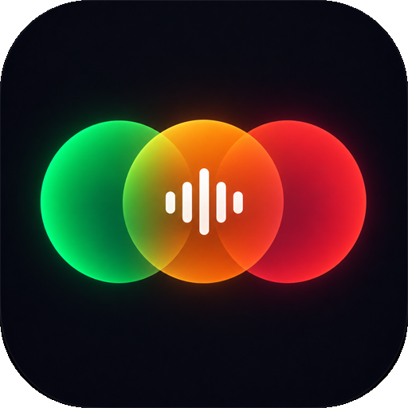

# Maestro

One player for **Spotify** and **YouTube**. Search both side by side, paste links from either, and build one
queue or playlist that mixes them. Maestro switches between the two automatically as tracks end.

- **Spotify** plays through your **Spotify desktop app** (SpotX works great), so a free account is all you need.
  There are no API keys and no Premium requirement: Maestro uses the app's own player and search (details below).
- **YouTube** plays in YouTube's embedded player inside Maestro's window. Search needs no API key.

**You only open Maestro.** It starts Spotify in the background, keeps Spotify's window hidden, and closes Spotify
again when you quit (if Maestro was the one that started it).

## Run it

Requirements: Windows 10/11, the [.NET 10 Desktop Runtime](https://dotnet.microsoft.com/download/dotnet/10.0),
and the Spotify desktop app. WebView2 (built into Windows 11 and current Windows 10) shows the UI.

Double-click `Maestro.cmd`. The first time, it builds `dist\Maestro.exe` (this needs the .NET 10 SDK). After that you can
run or pin `dist\Maestro.exe` directly. To build by hand:

```
dotnet publish src\Maestro -c Release -o dist
```

**First time:** if Spotify is already open without Maestro support, Maestro asks once to restart it. If Spotify
shows its login screen, Maestro brings that window up so you can sign in, then hides it again.

## Using it

| | |
|---|---|
| **Search** | Type to search Spotify and YouTube at once. Use the *All / Spotify / YouTube* filter to show one source. |
| **Paste a link** | Spotify tracks, albums, and playlists, and YouTube videos and playlists. You can play everything, add it to the queue, or save it as a Maestro playlist. |
| **Queue** | Drag to reorder. Includes shuffle and repeat (all / one). |
| **Autoplay** | When the queue runs low, Maestro adds recommendations so the music never stops: Spotify's song radio for Spotify tracks, YouTube's Mix for videos, or both interleaved (*Queue → Autoplay: Off / Same app / Spotify + YouTube*). Songs you add always play before autoplay's picks. |
| **Playlists** | Stored in `%APPDATA%\Maestro\playlists.json`. Add tracks from the ⋯ menu, or drag a track onto a playlist in the sidebar. |
| **Volume** | A single slider controls both YouTube and Spotify. |
| **Keys** | `Space` play/pause · `Ctrl+←/→` previous/next · `Shift+←/→` seek ±10s · `/` or `Ctrl+K` search |

Settings has switches for *Keep Spotify's window hidden* and *Close Spotify when Maestro closes* (both on by default).
When Maestro leaves Spotify running, it hands Spotify's window back minimized, so Spotify is never left invisible.

## How the Spotify side works

The Spotify desktop app is a Chromium web page that is already signed in to your account. When Spotify starts with
`--remote-debugging-port=9233`, Maestro can run code inside that page through the Chrome DevTools Protocol and use the
same internal objects Spotify's own UI uses:

- **Player:** play a specific track, pause, resume, seek, set the volume, and read the exact track and position.
  Starting a track takes under a second.
- **Search:** Spotify's own search. The query IDs it needs are read from the installed app's code, so search keeps
  working when Spotify updates.

Maestro starts Spotify with that flag when Spotify isn't running. If Spotify was already started without it, Maestro asks
before restarting it.

**Handoffs.** When a Spotify song is about to end, Maestro moves on about 0.3 s early, so Spotify's autoplay never
starts. If you skip inside Spotify or with your media keys, Maestro sees the track change and follows in its own
queue. When a YouTube video ends, Maestro starts the next Spotify track directly.

**Security note.** While Spotify runs with the debugging port, other programs on *this computer* can control the
Spotify app through it. The port only accepts connections from this machine. If you don't want that, leave the
autostart option off; restarting Spotify normally removes the port.

## Limitations

- Windows only.
- This relies on Spotify's internal (unofficial) app code. A big Spotify update could change it, and Maestro may need
  a fix when that happens.
- Spotify playlist and album imports from a link include up to 100 tracks.
- Some YouTube videos block embedding. Maestro tells you and skips them.
- The window uses its own WebView2 profile (in `%LOCALAPPDATA%\Maestro`), so you aren't signed in to YouTube there.

## Layout

```
src/Maestro/
  MainForm.cs           the window: WebView2 showing the UI; /api/* requests are answered in-process (no server/port)
  Api.cs                the API routes the UI calls
  SpotifyApp.cs         drives the Spotify app: start hidden, connect, player, search, restart, autostart, exit
  inject.js             the code Maestro runs inside Spotify's page
  Radio.cs              autoplay recommendations (Spotify song radio, YouTube Mix, or both)
  SpotifyLinks.cs       Spotify link parsing and metadata (public embed pages)
  YouTube.cs            YouTube link parsing, search, playlists
  Store.cs              settings + playlists in %APPDATA%\Maestro
  NativeMethods.cs      Win32 calls (window hiding, single instance, dark title bar)
  wwwroot/              the player UI (plain HTML/CSS/JS), embedded in the exe
tools/make-icon.ps1     regenerates maestro.ico
```
