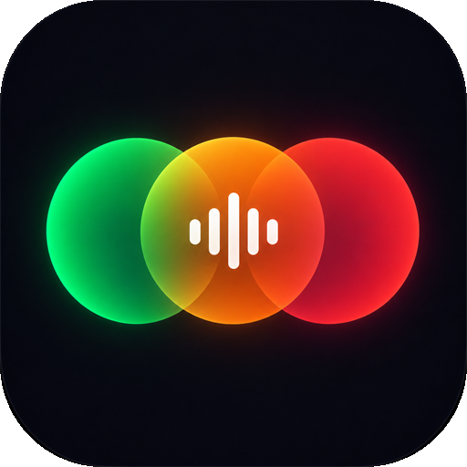

<p align="center">
  
</p>

# Maestro

**Spotify, YouTube, and SoundCloud in one Windows music player.** Search all three at once, mix songs from any of
them in one queue, and stop switching apps.

**Free** · **No ads** · **No setup** · **Windows 10 / 11**

[](https://github.com/QMjnh/maestro/releases/latest/download/Maestro-win-x64.exe)
[](https://qmjnh.github.io/maestro/)

[](#install)
[](https://github.com/QMjnh/maestro/releases/latest)
[-yellow?style=flat-square)](LICENSE)

## What you get

- **Three services, one player.** Spotify, YouTube, and SoundCloud all play in the same window.
- **One search.** Type once and see results from all three side by side, or paste a link from any of them.
- **One queue, mixed playlists.** Put songs from different services together. Maestro switches between them as each
  song ends.
- **Even volume.** Maestro levels every song to the same loudness, so a quiet Spotify song is never followed by a
  blaring YouTube video.
- **Home and autoplay.** Picks based on what you listen to, and music that keeps going when your queue runs out.
- **Zero setup.** Works with a free Spotify account. No Premium, no developer keys, nothing to configure.
- **Ad-free.** Maestro has no ads. Add [SpotX](https://github.com/SpotX-Official/SpotX) to your Spotify app and
  Spotify's ads are gone too.
- **Your library stays on your PC.** Playlists and liked songs are saved locally.
- **Ask an AI to DJ.** Press `Ctrl+J` and tell Claude, Codex, Gemini, Copilot, and others what you want to hear.

## Install

1. **Download [Maestro-win-x64.exe](https://github.com/QMjnh/maestro/releases/latest/download/Maestro-win-x64.exe)**
   and open it.
2. **For Spotify songs**, install the [Spotify desktop app](https://www.spotify.com/download) from spotify.com and
   sign in. YouTube and SoundCloud work without it.

> On the "Windows protected your PC" screen, click **More info**, then **Run anyway**.

**Want a Start menu entry and one-command updates?** Paste this into PowerShell instead (no admin needed):

```powershell
irm https://raw.githubusercontent.com/QMjnh/maestro/main/install.ps1 | iex
```

Run the same line again to update. Uninstall from **Settings › Apps** in Windows.
Installer options are in the [technical guide](docs/technical.md#installer-options).

**First launch:** if Spotify is already open, Maestro asks once to restart it. From then on, Maestro starts Spotify
hidden in the background and closes it when you quit. Change this anytime in Settings.

## Using Maestro

| | |
|---|---|
| **Home** | Picks from your Spotify home feed and listening history, plus related mixes from all three services. |
| **Search** | Search everything at once, or paste a song, album, or playlist link from any service. |
| **Queue** | Drag to reorder. Shuffle, repeat, and autoplay are in the player bar. |
| **Playlists** | Click the heart to like a song, click `+` to add it to a playlist, or drag songs onto a playlist in the sidebar. |

**Keyboard shortcuts:** `Space` play/pause · `Ctrl+←` / `Ctrl+→` previous/next · `Shift+←` / `Shift+→` skip back or
ahead 10 seconds · `Ctrl+K` or `/` search · `Ctrl+J` AI agent

## Ask an AI agent

Click **✦** in the player bar (or press `Ctrl+J`) to open a chat next to the player. Ask for things like *"play some
Daft Punk"*, *"queue the rest of this album"*, or *"save my queue as a playlist called Road trip"*, and watch it
happen.

- **Use the AI plan you already pay for.** Claude, Codex, Cursor, Gemini CLI, GitHub Copilot, OpenCode, Antigravity,
  and more, all on your existing sign-in. One click on **Install** sets up any agent.
- **You decide what it can touch.** Out of the box, the agent controls Maestro and searches the web. Your files and
  programs stay off-limits until you open them up.

Already use Claude Code, Cursor, or another AI app? Connect it to Maestro too:
see [Connect other AI apps](docs/technical.md#connect-other-ai-apps-mcp).

## How it compares

| | Maestro | Soundiiz / SongShift | Nuclear | Spotube |
|---|---|---|---|---|
| **What it is** | Player for several services | Playlist transfer tool | Open-source player | Spotify-style app that streams from YouTube |
| **Plays from several services** | **Spotify, YouTube, SoundCloud** | No (copies playlists only) | YouTube, SoundCloud | YouTube audio only |
| **Plays real Spotify audio** | **Yes** | No | No | No |
| **One queue across services** | **Yes** | No | Partly | No |
| **Works with free Spotify** | **Yes** | Yes | — | Yes (needs a client ID) |
| **Evens out volume across services** | **Yes** | — | Basic | Basic |
| **No developer keys needed** | **Yes** | No | Yes | No |

## FAQ

### Is Maestro free?
Yes, for personal use. Businesses need a separate license (see [License](#license)).

### Do I need Spotify Premium?
No. A free Spotify account works.

### Do I need API keys or a developer account?
No. Download it, open it, and search.

### Can I mix Spotify and YouTube songs in one playlist?
Yes. Add songs from any of the three services to the same queue or playlist, and Maestro plays them in order.

### Is Maestro ad-free?
Yes. Maestro has no ads. Add [SpotX](https://github.com/SpotX-Official/SpotX) to your Spotify app to remove Spotify's
ads as well.

### Which systems does it run on?
Windows 10 and 11.

### How does it work?
The [technical guide](docs/technical.md) explains how each service plays, how volume leveling works, and how to build
Maestro yourself.

## License

Maestro is free for personal, noncommercial use, including modifying it and building it yourself. Business use needs a
separate license: [open an issue](https://github.com/QMjnh/maestro/issues) to get one.

Maestro is source-available under the [Business Source License 1.1](LICENSE). Each release becomes open source
(GPL-2.0-or-later) four years after it ships.
